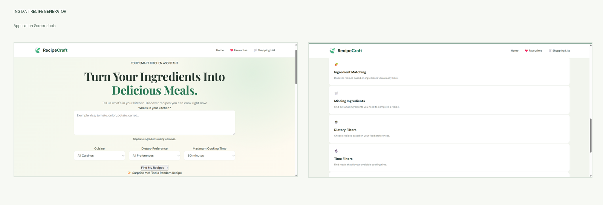
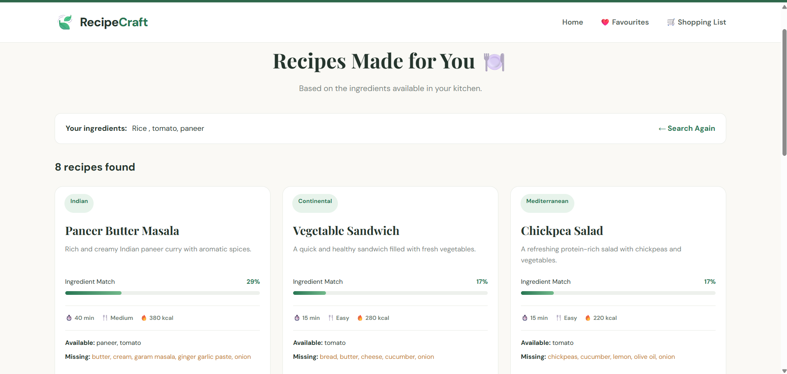
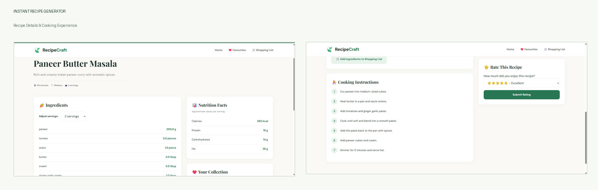
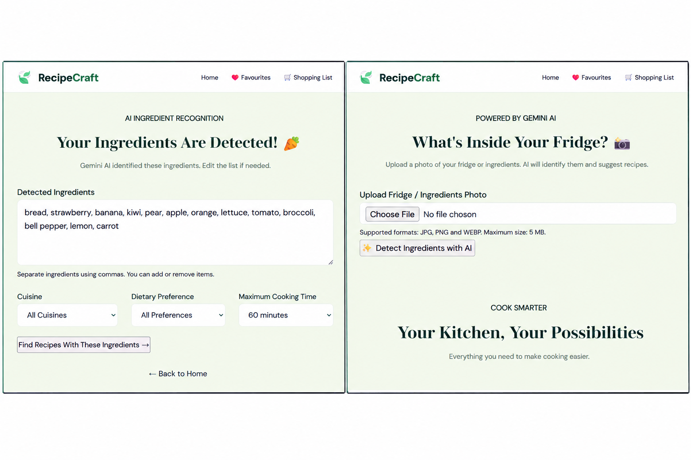
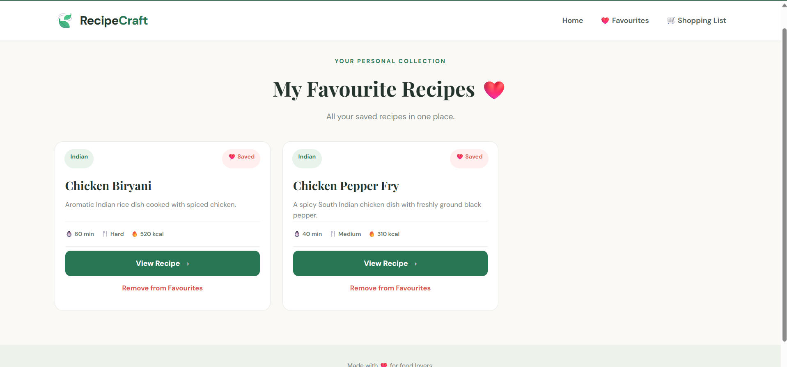
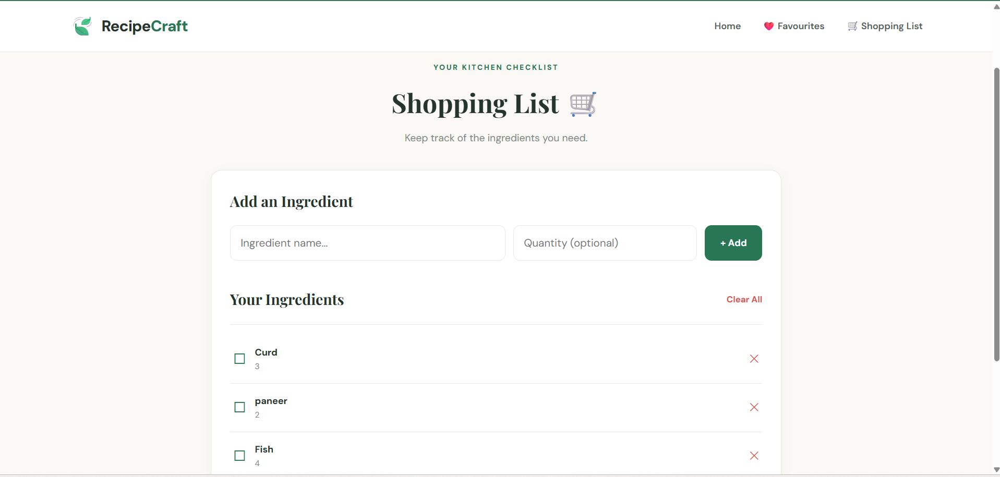

# 🍳 Instant Recipe Generator

<p align="center">
  <strong>Turn Your Available Ingredients into Delicious Recipes!</strong>
</p>

<p align="center">
  An AI-powered recipe recommendation platform that helps users discover recipes based on available ingredients and even identify ingredients directly from fridge images using Google Gemini AI.
</p>

<p align="center">
  <a href="https://instant-recipe-generator.onrender.com">🌐 Live Demo</a> •
  <a href="https://github.com/Malavika-2405/Instant-Recipe-Generator.">💻 GitHub Repository</a>
</p>

---

## 📌 Project Overview

Instant Recipe Generator is a web-based application designed to simplify everyday cooking decisions. Users can enter ingredients they already have or upload a fridge image to automatically detect visible ingredients using Google Gemini AI.

Based on the available ingredients, the application recommends suitable recipes, displays missing ingredients, and provides detailed cooking instructions.

The platform also includes recipe management features to make cooking easier and more convenient.

## ✨ Key Features

- **AI-Powered Ingredient Detection:** Upload a fridge or food image and identify ingredients using Google Gemini AI.
- **Ingredient-Based Recipe Search:** Generate recipes based on available ingredients.
- **Missing Ingredient Suggestions:** Identify additional ingredients needed for each recipe.
- **Cuisine Filters:** Explore recipes from different cuisines.
- **Dietary Preferences:** Filter vegetarian, vegan, and non-vegetarian recipes.
- **Cooking Time Filters:** Find recipes based on available cooking time.
- **Detailed Recipe Instructions:** View ingredients, preparation steps, and cooking instructions.
- **Nutrition Information:** View estimated nutritional values and macros.
- **Favourite Recipes:** Save and manage favourite recipes.
- **Recipe Ratings:** Rate recipes.
- **Serving Size Adjustment:** Adjust ingredient quantities based on servings.
- **Surprise Me:** Discover random recipes.
- **Shopping List:** Manage ingredients needed for cooking.

## 📸 Application Screenshots

### 1. Homepage



### 3. Recipe Recommendations



### 4. Recipe Details



### 5. AI-Powered Fridge Image Detection



### 6. Favourite Recipes



### 7. Shopping List



> Note: Replace the screenshot placeholders with your actual application screenshots using the same filenames.

## 🛠️ Technology Stack

| Category | Technologies |
|---|---|
| Frontend | HTML, CSS, JavaScript |
| Backend | Python, Flask |
| AI Integration | Google Gemini AI |
| Database | SQLite |
| Image Processing | Pillow |
| Environment Management | Python dotenv |
| Deployment | Render |
| Version Control | Git, GitHub |

## 🏗️ Project Structure

```text
Instant-Recipe-Generator/
│
├── app.py
├── recipes.py
├── database.py
├── requirements.txt
├── README.md
├── .gitignore
│
├── database/
│   └── recipes.db
│
├── templates/
│   ├── base.html
│   ├── index.html
│   ├── results.html
│   ├── recipe_details.html
│   ├── ingredient_review.html
│   ├── favorites.html
│   └── shopping_list.html
│
├── static/
│   ├── css/
│   │   └── style.css
│   ├── js/
│   │   └── script.js
│   └── images/
│
├── utils/
│   ├── __init__.py
│   ├── recipe_engine.py
│   └── image_detector.py
│
└── screenshots/
```

## ⚙️ Installation and Setup

### Prerequisites

- Python 3.10+
- Git
- Google Gemini API Key

### 1. Clone the Repository

```bash
git clone https://github.com/Malavika-2405/Instant-Recipe-Generator..git
cd Instant-Recipe-Generator
```

### 2. Create a Virtual Environment

```bash
python -m venv venv
```

### 3. Activate the Virtual Environment

**Windows:**

```powershell
venv\Scripts\activate
```

### 4. Install Dependencies

```bash
pip install -r requirements.txt
```

### 5. Configure Environment Variables

Create a `.env` file in the project root directory.

```env
GEMINI_API_KEY=your_gemini_api_key
```

Replace the placeholder with your own Gemini API key.

### 6. Run the Application

```bash
python app.py
```

Open your browser and visit:

```text
http://127.0.0.1:5000
```

## 🔄 How It Works

1. Users enter available ingredients manually or upload a fridge image.
2. Google Gemini AI identifies visible ingredients from the uploaded image.
3. Users review and edit the detected ingredients.
4. The recipe engine matches available ingredients with the recipe dataset.
5. Matching recipes and missing ingredients are displayed.
6. Users can explore instructions, nutrition information, save favourites, rate recipes, and manage shopping lists.

## 🚀 Live Deployment

The application is deployed using Render.

**Live Application:** https://instant-recipe-generator.onrender.com

## 🔮 Future Enhancements

- Expand the recipe database with more cuisines and dishes.
- Introduce personalized recipe recommendations.
- Add user authentication and personalized profiles.
- Improve ingredient detection for partially visible and overlapping ingredients.
- Integrate a persistent cloud database.

## 👩‍💻 Author

**Malavika P**

B.E. Computer Science and Engineering

GitHub: [Malavika-2405](https://github.com/Malavika-2405)

---

<p align="center">
  <strong>Made with ❤️ to make everyday cooking smarter and easier!</strong>
</p>
